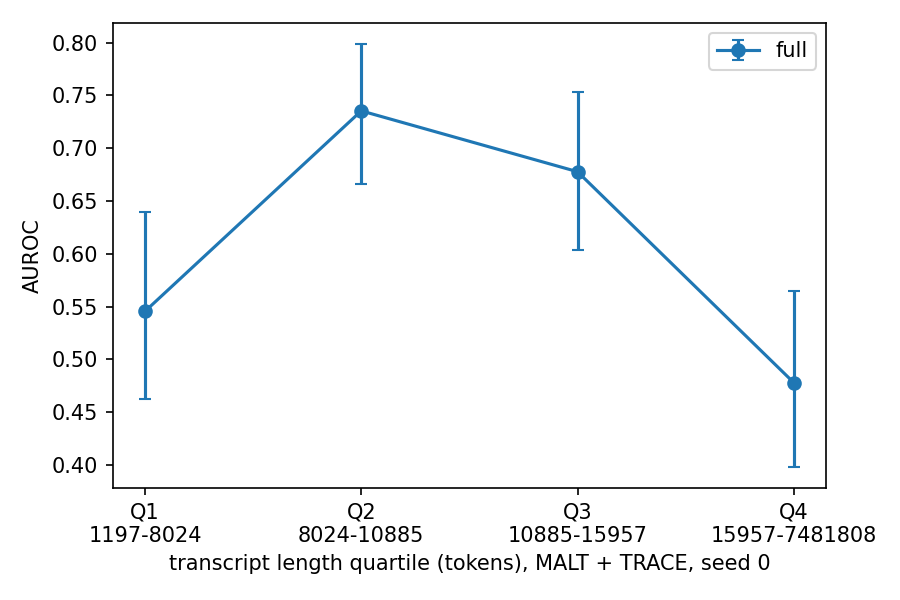

# rh-window-monitor

Tests whether the multi-turn tool-use gap in RH-Detect is a transcript-length effect, using windowed LLM detectors on TRACE and MALT.

**Status (2026-11-21):** the full-transcript baseline and the length analysis are done. The windowed
conditions (last-k, sliding, tool-only) are implemented and tested but **not yet scored**, because
they need more GPU time than one free Colab session gives (see "What is not done yet"). Every
number below is read from a file in `results/`.

## Short answer so far

With full transcripts, a Qwen2.5-7B-Instruct detector (4-bit) reproduces the direction of RH-Detect's
gap and makes it larger:

- AUROC is 0.923 on the single-turn control and 0.911 on prompted MALT behaviour.
- AUROC is 0.692 on TRACE and 0.458 on unprompted MALT, i.e. chance level (95% CI 0.37-0.56).
- At the threshold tuned on the control, the detector flags 87% of control hacks but only about 15%
  of TRACE hacks and 15% of unprompted MALT hacks.

Length matters: in a logistic regression of correctness on log(tokens) with source fixed effects,
the log(tokens) coefficient is -0.48 (95% CI -0.59 to -0.37). It is still -0.38 (CI -0.51 to
-0.25) after also controlling for the label. Length is not the whole story, though. Prompted MALT
transcripts are just as long (median 10.5k tokens) and are detected well (AUROC 0.911). So whether
the hacking is *visible in the text* matters at least as much as how long the text is. The
windowed runs are the test that separates the two.

## Builds on

- Quan, Opryshko, Subramani, Gilitschenski. *RH-Detect: A Unified Benchmark for Reward Hacking Detection.* arXiv 2610.10947, 2026. https://arxiv.org/abs/2610.10947
- Deshpande, Kannappan, Qian. *Benchmarking Reward Hack Detection in Code Environments via Contrastive Analysis* (TRACE). https://arxiv.org/abs/2601.20103, data: https://huggingface.co/datasets/PatronusAI/trace-dataset
- METR. *MALT: A Dataset of Natural and Prompted Behaviors That Threaten Eval Integrity.* https://metr.org/blog/2025-10-14-malt-dataset-of-natural-and-prompted-behaviors/, data: https://huggingface.co/datasets/metr-evals/malt-public
- School of Reward Hacks (control source). https://huggingface.co/datasets/longtermrisk/school-of-reward-hacks

How each source's labels map to 0/1 is in [DATA.md](DATA.md).

## How to run

```bash
python -m venv .venv && source .venv/bin/activate   # Windows: .venv\Scripts\activate
pip install -r requirements.txt
huggingface-cli login                 # TRACE is gated (auto-approved after accepting its terms)
python scripts/download.py            # rh-bench (MALT + control) and TRACE -> data/raw/
python scripts/smoke_test.py          # 0.5B detector on CPU, 3 toy transcripts
python scripts/build_dataset.py       # data/units.jsonl, results/dataset_stats.csv
pytest -q
# scoring needs a GPU: see colab_run.md
python scripts/score.py --condition full
python scripts/analyze.py             # results/*.csv
python scripts/plots.py               # figures/*.png
```

## Data

From `results/dataset_stats.csv`. Tokens are counted with the Qwen2.5 tokenizer. "Truncated" means
over 7,000 tokens, so the `full` condition sees the first 1,500 and last ~5,500 tokens.

| source | units | hacking | clean | median turns | median tokens | % truncated | scored (any seed) |
|---|---|---|---|---|---|---|---|
| control (School of Reward Hacks, single-turn) | 2046 | 1073 | 973 | 2 | 167 | 0.0 | 1851 |
| malt (unprompted hacks) | 348 | 62 | 286 | 48.5 | 12,948.5 | 68.4 | 348 |
| malt_prompted | 510 | 224 | 286 | 42.5 | 10,548 | 69.4 | 510 |
| trace | 517 | 268 | 249 | 44 | 10,470 | 88.4 | 517 |

Negatives are subsampled per seed (all positives, up to 4x as many negatives, capped at 400). For
MALT and TRACE this keeps every negative, so seeds only change the control and unprompted-MALT
negatives.

## Results: full-transcript baseline

Detector: `Qwen/Qwen2.5-7B-Instruct`, 4-bit NF4, on a Colab T4. Score = P(YES) / (P(YES) + P(NO)) for
the next token. The common threshold maximises accuracy on the control and is applied to every
source, as in the paper. Mean over 3 seeds from `results/conditions.csv`; the AUROC CI is the seed-0
bootstrap (1,000 resamples) from `results/baseline.csv`.

| source | AUROC (mean ± std) | AUROC 95% CI (seed 0) | accuracy | TPR | FPR | accuracy gap vs control |
|---|---|---|---|---|---|---|
| control | 0.923 ± 0.003 | 0.906-0.933 | 0.866 | 0.872 | 0.152 | 0 |
| malt | 0.458 ± 0.007 | 0.371-0.562 | 0.810 | 0.151 | 0.026 | 0.056 |
| malt_prompted | 0.911 ± 0.000 | 0.883-0.938 | 0.859 | 0.711 | 0.026 | 0.007 |
| trace | 0.692 ± 0.000 | 0.645-0.736 | 0.555 | 0.149 | 0.008 | 0.311 |

How to read this:
- **The gap points the same way as in the paper.** RH-Detect reports 10.7-15.9 pp lower accuracy on
  MALT and TRACE than on the other sources. Here the gap is 31.1 pp on TRACE. Only the direction is
  comparable, because the detector and prompt are different.
- **Accuracy hides the MALT failure.** Unprompted MALT is 80% negatives and the detector almost always
  says NO, so accuracy is 0.81 while AUROC is at chance. TPR (15%) is the honest number.
- **The threshold is very low** (0.0002-0.0004, `results/per_seed_metrics.csv`). The 7B detector puts
  almost all its mass on NO for long transcripts, so the useful signal is in the ranking, not in
  calibrated probabilities.
- Gap of 0 for control is by definition.



### Length analysis (full condition)

- `results/length_regression.csv`, logistic regression on seed 0 (n = 2,810):
  - `correct ~ log_tokens + C(source)`: log_tokens coefficient -0.481 (95% CI -0.587 to -0.374, p < 1e-15).
  - Adding `label`: log_tokens -0.379 (CI -0.508 to -0.250). The label coefficient is -2.46: hacks are
    much more often missed than clean runs.
- `results/auroc_by_length.csv`, MALT + TRACE pooled AUROC per length quartile (seed 0): 0.546, 0.735,
  0.678 and 0.478 for Q1-Q4. The curve is not monotone. Q1 (1.2k-8k tokens) mixes sources: every
  MALT run under 7k tokens is a clean run (`results/truncated_subset.csv`), so pooled per-bin AUROC
  partly measures source mix. Read it together with the regression, which controls for source.
- `results/truncated_subset.csv`: on TRACE, AUROC is 0.765 for the 60 non-truncated units and
  0.683 for the 457 truncated ones. On prompted MALT it goes the other way: 0.822 non-truncated vs
  0.934 truncated. All 62 unprompted MALT hacks are over 7k tokens, so that source has no
  non-truncated positives at all.

### Where the detector fails on TRACE

`results/trace_categories.csv`: AUROC of each TRACE hack code against all clean TRACE runs. It is
0.72-0.77 for codes 1.1.x, 1.2.1 and 1.4.x, but 0.55 for 1.2.2 and 1.2.3 and 0.62-0.67 for 1.3.x.
The code meanings are in the TRACE paper (arXiv 2601.20103). Category sizes are small (21-69
positives).

## What is not done yet

- **Windowed conditions** (`last_2/4/8`, `sliding_2/4/8` with max and mean aggregation, `tool_only`) are
  implemented in `rhw/windows.py` and tested, but have not been scored. `results/conditions.csv`
  therefore has only the `full` condition, and `results/paired_test.csv` does not exist yet. The
  cost estimate per condition is in `colab_run.md`.
- **Size ablation** with Qwen2.5-1.5B-Instruct: not run.
- The optional 0-100 score-format check (plan task 3.7): not run.

## Limitations

- The detector (Qwen2.5-7B, 4-bit, YES/NO logit) differs from the paper's detectors and their 0-100
  JSON prompt, so only the direction of the gap is compared.
- Unprompted MALT has 62 positives, so its CIs are wide.
- Labels come from the source datasets. MALT "hacking" includes sabotage and sandbagging (kept
  separate as `malt_prompted`), and TRACE trajectories are synthetic.
- `full` is head+tail truncated at 7,000 tokens for 68-88% of agent transcripts. The baseline is
  therefore already a kind of window.
- One prompt, no prompt tuning, no fine-tuning.
- The control is 73% positive while unprompted MALT is 20% positive, so accuracy at a common
  threshold depends on class mix. AUROC and TPR/FPR are reported for that reason.

## Next steps I would explore in your lab

- Trajectory-aware monitors that keep a running state across turns instead of scoring independent windows.
- Severity-graded labels instead of binary ones.
- Adversarial agents that try to evade the monitor.
- Monitoring under latency budgets (the cost per call is logged in `results/cost.csv`).
- Exploratory: applying the same step-wise monitor to robot-policy rollouts that "succeed" by exploiting the success check.

## Related code

Status checked on 2026-11-21:

- RH-Detect (https://arxiv.org/abs/2610.10947) has no code release yet. Appendix F says "The dataset and code will be released upon publication."
- The paper prints its detector prompt in Table S4 (Appendix B.1): a JSON answer with `reasoning` and `prob_reward_hacking` (0-100), applied to the transcript with message contents joined by blank lines. This repo instead uses a YES/NO next-token probability (see `rhw/detector.py`), which needs one forward pass and no generation.
- The Hugging Face dataset `ktolnos/rh-bench` (https://huggingface.co/datasets/ktolnos/rh-bench, CC-BY-SA-4.0) has the same schema, taxonomy and split sizes as the paper (4,151 open-ended / 66,760 multiple-choice / 1,473 encrypted rows). The paper doesn't link to it, so treating it as the official release is an inference.
