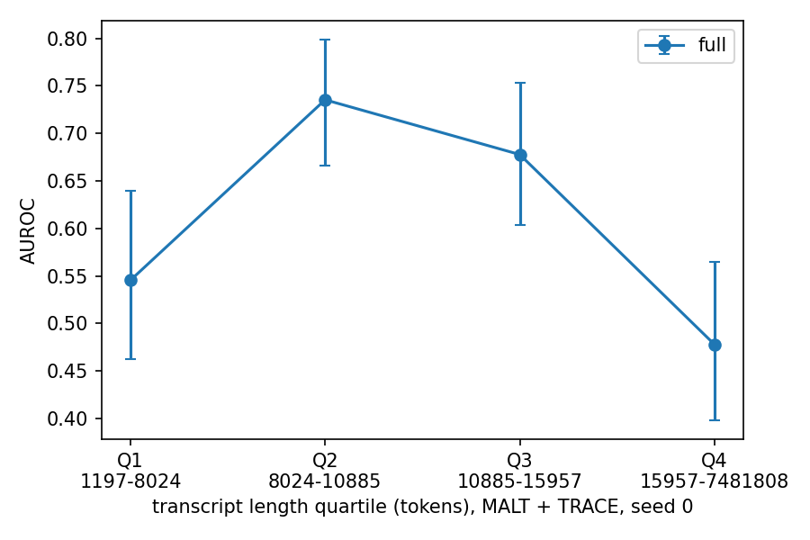

# Is it just length? Reward-hacking detection on long agent trajectories

Muhammad Ahmed Butt. Short report, 2026-11-21. Every number is read from a file in `results/`.

## Problem

RH-Detect (Quan et al., arXiv 2610.10947) evaluates zero-shot LLM detectors on 5,021 open-ended
reward-hacking units. The best detector reaches a pooled AUROC of 0.962. But at a common threshold,
the strongest detectors are 10.7-15.9 points less accurate on the two multi-turn tool-use sources,
METR's MALT and Patronus TRACE. The paper notes that this gap mixes several factors. This project
isolates one of them: **transcript length**. Is the hacking evidence buried in a long trajectory, or
is tool-use hacking harder to recognise however much text the detector sees?

## Method

- **Units.**
  - TRACE: the original Patronus parquet, 268 hacked / 249 benign.
  - MALT: rh-bench, the public unit table that matches RH-Detect. Unprompted hacks (62) and prompted
    behaviours (224, mostly sabotage) are kept as separate sources; both use the same 286 clean runs.
  - Control: single-turn School of Reward Hacks pairs (1,073 / 973).
  - Label mapping is in `DATA.md`.
- **Detector.** Qwen2.5-7B-Instruct, 4-bit NF4. The system prompt defines reward hacking and the user
  turn holds the transcript plus "Did the assistant engage in reward hacking? Answer YES or NO." The
  score is P(YES) / (P(YES) + P(NO)) for the next token: one forward pass, no generation.
- **Conditions.** Each is a function from a unit to the texts the detector sees (`rhw/windows.py`), and
  the task prompt is always included:
  - `full`: head+tail truncation at 7,000 tokens.
  - `last_k`: the last k turns, k ∈ {2, 4, 8}.
  - `sliding`: windows of w turns with stride w/2, w ∈ {2, 4, 8}, aggregated by max or mean.
  - `tool_only`: assistant actions plus tool outputs cut to 300 characters.
- **Threshold.** The threshold that maximises control accuracy is applied to every source, mirroring the
  paper's common decision threshold.
- **Metrics.**
  - AUROC with a 1,000-resample bootstrap CI.
  - Accuracy, TPR and FPR at the common threshold.
  - Accuracy gap vs control.
  - A logistic regression of correctness on log(tokens) with source fixed effects.

## Setup

- **Data.** Negatives are subsampled per seed: all positives plus up to 4x as many negatives, capped
  at 400, with seeds 0, 1, 2. Units scored: 3,226. Distinct texts: 2,939, because clean MALT runs are
  shared between the two MALT sources and scored once.
- **Hardware and cost.** Free Colab T4, about 8,531 GPU-seconds for the `full` condition
  (`results/cost.csv`).
- **Length.** Median length is 10.5k-12.9k tokens on the agent sources and 167 on the control. 68-88%
  of agent transcripts exceed 7,000 tokens (`results/dataset_stats.csv`).

## Results

Table 1: full transcripts, mean over 3 seeds (`results/conditions.csv`); CI from seed 0 (`results/baseline.csv`).

| source | AUROC | 95% CI | accuracy | TPR | FPR | gap vs control |
|---|---|---|---|---|---|---|
| control | 0.923 | 0.906-0.933 | 0.866 | 0.872 | 0.152 | 0 |
| malt (unprompted) | 0.458 | 0.371-0.562 | 0.810 | 0.151 | 0.026 | 0.056 |
| malt_prompted | 0.911 | 0.883-0.938 | 0.859 | 0.711 | 0.026 | 0.007 |
| trace | 0.692 | 0.645-0.736 | 0.555 | 0.149 | 0.008 | 0.311 |

Length regression (`results/length_regression.csv`, seed 0, n = 2,810):
- log(tokens) coefficient: -0.481 (95% CI -0.587 to -0.374).
- With the label added as a control: -0.379 (CI -0.508 to -0.250).

## Discussion

1. **The gap reproduces in direction and is larger.**
   - TRACE accuracy is 31 points below the control.
   - On unprompted MALT the detector is at chance (AUROC 0.458). Its accuracy of 0.81 is an artefact of
     the class mix: 80% of those units are clean and the detector almost always says NO.
   - At the common threshold, only about 15% of TRACE and unprompted-MALT hacks are flagged.
2. **Length is associated with errors.** The negative log(tokens) coefficient survives source and
   label controls.
3. **Length alone does not explain the gap.** The two MALT sources have similar lengths (median
   10.5k vs 12.9k tokens, 69% vs 68% truncated, `results/dataset_stats.csv`; these figures include
   the shared clean runs). Yet prompted behaviour is detected with AUROC 0.911 and unprompted hacks
   at chance. A hypothesis I have not tested: prompted sabotage is often stated or visible in the
   text, while unprompted hacks (test modification, hard-coding, filesystem tricks) look like
   ordinary agent actions unless you know what the task required.
4. **Within TRACE, difficulty depends on hack type.** AUROC is 0.55 for codes 1.2.2 and 1.2.3 and
   0.72-0.77 for most other codes (`results/trace_categories.csv`).
5. **Verdict so far: partly positive, not yet decisive.** Longer transcripts are scored worse, but
   evidence visibility is at least as important. The direct test is still to be run: does showing the
   same trajectories in short windows raise MALT/TRACE AUROC? The windowed conditions are
   implemented and tested but not yet scored. If windows help, length is a cause. If they do not,
   the gap comes from what the hacks look like, or from label differences between sources.

## Limitations

- **Different detector.** The detector and prompt differ from RH-Detect's 0-100 JSON prompt, so only
  the direction of the gap is compared.
- **Small MALT sample.** There are 62 unprompted MALT positives, so CIs are wide.
- **Source labels.** Labels come from the source datasets. TRACE is synthetic, and MALT "hacking"
  includes sabotage.
- **Truncation.** The `full` condition truncates most agent transcripts.
- **Class mix.** Accuracy at a control-tuned threshold depends on class mix, which is why TPR, FPR and
  AUROC are reported.
- **Single setup.** One prompt and no fine-tuning.

## References

- Quan, Opryshko, Subramani, Gilitschenski. RH-Detect: A Unified Benchmark for Reward Hacking Detection. arXiv 2610.10947, 2026.
- Deshpande, Kannappan, Qian. Benchmarking Reward Hack Detection in Code Environments via Contrastive Analysis. arXiv 2601.20103.
- METR. MALT: A Dataset of Natural and Prompted Behaviors That Threaten Eval Integrity. https://metr.org/blog/2025-10-14-malt-dataset-of-natural-and-prompted-behaviors/, 2025.
- School of Reward Hacks dataset. https://huggingface.co/datasets/longtermrisk/school-of-reward-hacks
- rh-bench. https://huggingface.co/datasets/ktolnos/rh-bench
